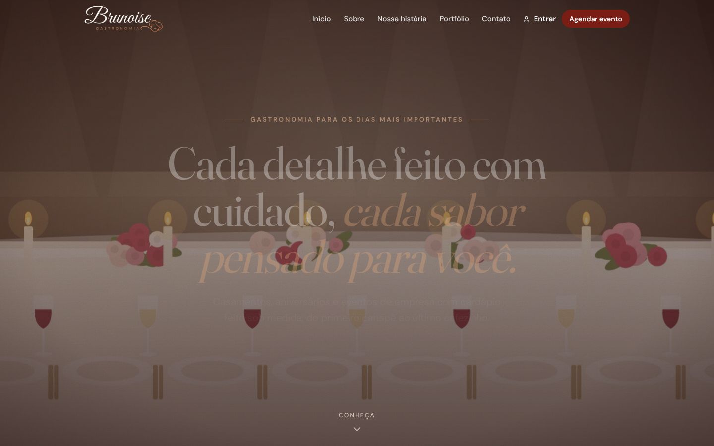
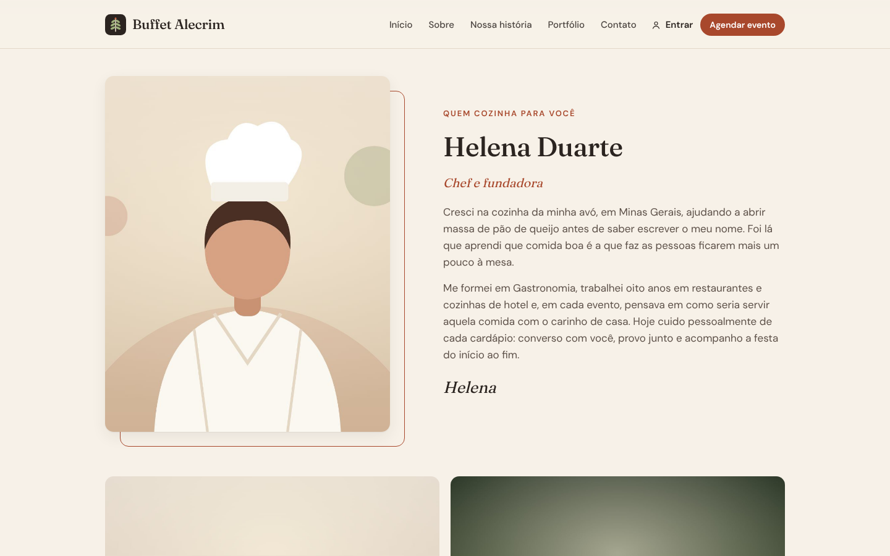
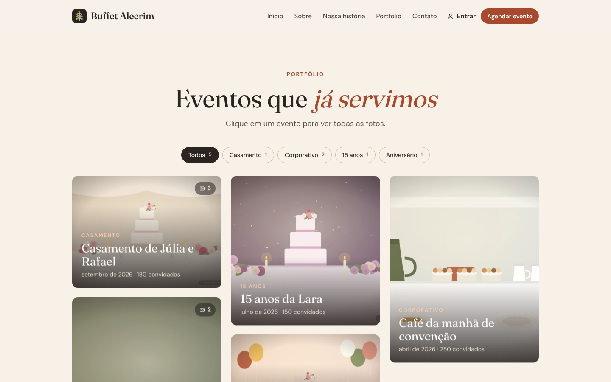
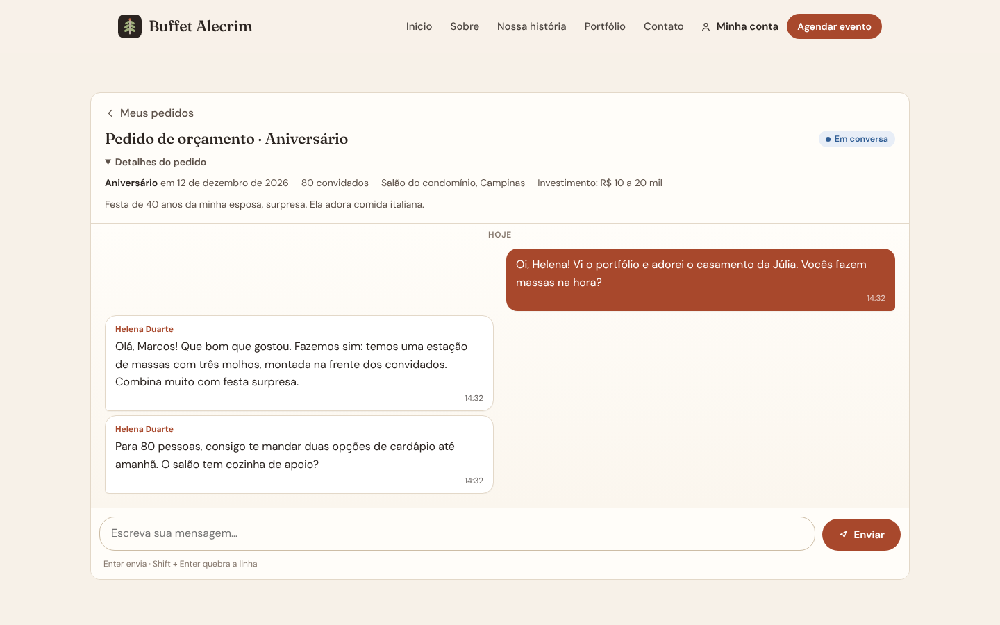
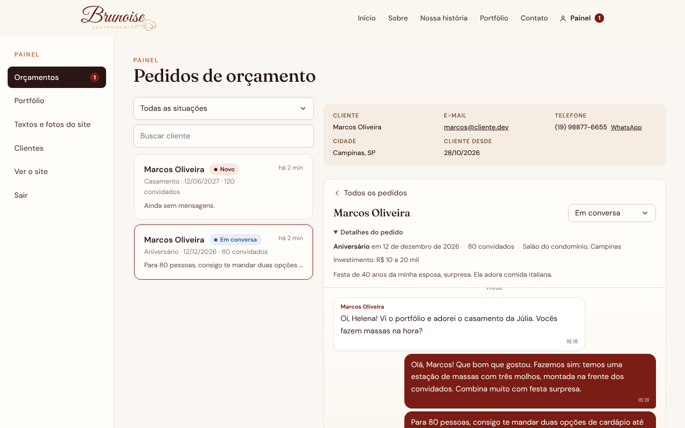
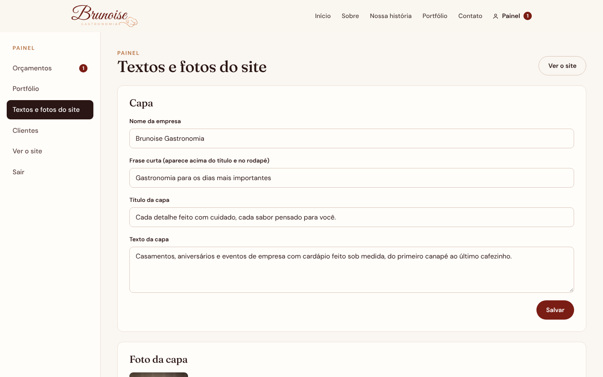
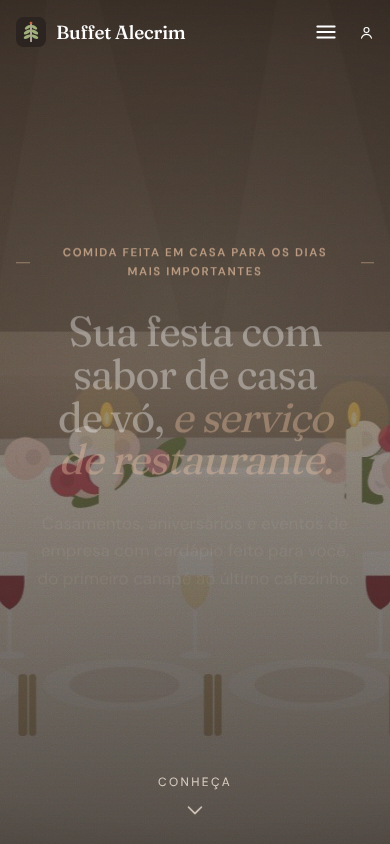

# Brunoise Gastronomia · site do buffet

Site completo para um buffet: apresentação da dona e da história da empresa, portfólio de
eventos com fotos, área do cliente e **pedido de orçamento que vira uma conversa** entre o
cliente e o buffet, tudo guardado no próprio site. A dona edita textos, fotos e portfólio por
um painel, sem mexer em código.

Feito com **FastAPI**, **SQLAlchemy 2** e **PostgreSQL**, com a interface em JavaScript puro
servida pela própria API.

> Marca, logo e cores da **Brunoise Gastronomia** (vinho e cobre da logo, sobre marfim). A
> chef "Helena Duarte", os textos de história e os eventos do portfólio de demonstração são
> exemplos, e as fotos são ilustrações. No site de verdade, tudo é trocado pelo painel.



## O que o site faz

**Para os visitantes**
- **Apresentação**: capa com foto, seção *Sobre mim* (foto, biografia e mais fotos) e
  *Nossa história* (como a empresa foi fundada, com ano de fundação e foto).
- **Portfólio**: eventos com várias fotos, filtro por tipo (casamento, 15 anos, corporativo…),
  página de cada evento e visualização ampliada das fotos (setas do teclado funcionam).
- Botão **Agendar evento** sempre à vista: leva ao pedido de orçamento.
- **Corações e comentários** nos eventos do portfólio: qualquer visitante vê; quem entra na conta
  deixa um coração ou um comentário/feedback. A dona responde com o selo do buffet e pode apagar
  comentários. Publicamente aparecem só o primeiro nome e a inicial do sobrenome.
- Acabamento de site profissional: capa em tela cheia com zoom lento na foto, números do
  buffet que contam ao aparecer (anos de história, eventos, convidados), faixa animada com os
  tipos de evento, seção *Para cada ocasião* com a capa de cada tipo, galeria em mosaico e
  visualizador de fotos com miniaturas e gesto de arrastar no celular. As animações respeitam
  quem pede "menos movimento" no sistema.

**Para os clientes**
- **Cadastro** com nome, e-mail, telefone/WhatsApp e cidade. Quem clica em *Agendar evento*
  sem conta cria a conta e volta direto para o pedido.
- **Pedido de orçamento em três etapas** (o evento, detalhes, revisar): tipo de evento em
  cartões com ícone, data, convidados com botões de +/−, local, faixa de investimento e
  detalhes. O pedido abre uma **conversa** com o buffet, onde os dois lados trocam mensagens
  e **fotos** (botão de foto, colar ou arrastar; prévia com legenda antes de enviar).
- Na revisão do pedido, cada item tem *alterar*: abre uma aba só com aquele campo, sem
  voltar ao início.
- **Minha conta**: lista de pedidos com situação e aviso de mensagens novas.
- **Notificações no celular e no computador** (barra de notificações do sistema): o cliente
  ativa com um toque e recebe mensagens do buffet, umas divertidas, com trocadilhos puxando
  para uma festa, e outras tranquilas, convidando a ver as fotos e conhecer a história. São
  2 por dia, em horários sorteados entre 7h e 19h (horário de Brasília). Depois das 19h
  nada é enviado. Tocar na notificação abre a página certa do site.

**Para a dona do buffet (painel)**
- **Orçamentos**: caixa de entrada com busca e filtro por situação (novo, em conversa,
  proposta enviada, fechado, não fechado), conversa ao lado e **ficha do cliente** com
  e-mail, telefone (com atalho para o WhatsApp), cidade e data de cadastro.
- **Portfólio**: publicar, editar e excluir eventos; enviar várias fotos de uma vez
  (arrastando), reordenar e escolher a capa.
- **Textos e fotos do site**: capa, biografia, história, contato e todas as fotos.
- **Clientes**: todos os cadastrados, com contato e quantidade de pedidos.
- **Resultados**: a central de números do buffet, lida da planilha de estoque, DRE e
  precificação (.ods ou .xlsx). Mostra receita, lucro e margem do ano, eventos e convidados,
  ticket por convidado, valor em estoque, preço sugerido por pessoa e os itens para repor, com
  gráficos de receita x custos por mês, despesas por grupo, receita x insumos por evento,
  composição do preço por pessoa e estoque por tipo.
  No computador (Chrome ou Edge), a dona conecta o arquivo uma vez: a cada Ctrl+S no
  LibreOffice o painel relê a planilha em até 2 segundos e envia o resumo ao site. No celular,
  o painel mostra os últimos números enviados.
- **Notificações**: quantos clientes ativaram, os horários sorteados de hoje e todas as
  mensagens que podem ser enviadas.

| Sobre mim | Portfólio |
|---|---|
|  |  |
| **Conversa do orçamento (cliente)** | **Painel: orçamentos e ficha do cliente** |
|  |  |
| **Painel: textos e fotos** | **No celular** |
|  |  |

## Detalhes técnicos

| Tema | Como aparece no código |
|---|---|
| API REST | FastAPI com validação Pydantic, erros em português campo a campo, OpenAPI em `/docs` |
| Banco | SQLAlchemy 2 (ORM tipado), SQLite no desenvolvimento e PostgreSQL em produção |
| Fotos | Guardadas no banco (sobrevivem a novos deploys). Toda foto é reaberta pelo Pillow: só entra imagem de verdade, o tamanho cai para no máximo 1920 px e os dados de GPS/EXIF do celular são removidos. Cache de um ano no navegador |
| Conversa | Mensagens novas por consulta a cada 4 s (`?after=`), sem WebSocket: funciona em qualquer hospedagem. Contagem de não lidas por id da última mensagem lida. Fotos da conversa são particulares: o endereço leva uma chave aleatória que só os participantes recebem |
| Segurança | Senhas com PBKDF2 + sal, JWT, limite de tentativas de login, cada cliente só vê os próprios pedidos (pedido alheio responde 404), cadastro nunca cria administrador, cabeçalhos CSP / nosniff / frame-ancestors |
| Qualidade | 100 testes com pytest rodando no SQLite **e no PostgreSQL** a cada push (GitHub Actions), Ruff |
| Notificações | Web Push implementado no próprio projeto (RFC 8291 para cifrar, RFC 8292/VAPID para assinar), testado contra o exemplo oficial da RFC. Funciona no Chrome, Edge, Firefox e Safari (no iPhone, com o site adicionado à Tela de Início). A chave do site é gerada e guardada no banco. Só aceita endereços dos serviços de push conhecidos (Google, Mozilla, Apple, Microsoft) |
| Resultados | A planilha é lida no navegador (SheetJS) e desenhada com Chart.js, os dois carregados só nessa aba. O arquivo nunca sai do computador: o site guarda só o resumo em JSON (`PUT /admin/dashboard`, até 2 MB, só a administração). Atualização ao vivo pela File System Access API, conferindo a data de alteração do arquivo a cada 2 s |
| Entrega | Docker e Blueprint do Render (`render.yaml` com PostgreSQL; `render-demo.yaml` para demonstração) |

```
app/
├── main.py           # monta a aplicação, cabeçalhos de segurança, site em /
├── models.py         # tabelas: usuários, conteúdo, fotos, eventos, pedidos, mensagens
├── schemas.py        # validação de entrada e formato de saída
├── images.py         # tratamento das fotos enviadas (Pillow)
├── routers/          # auth, site, portfolio, quotes, push, dashboard
├── seed.py           # conta da administração e site de demonstração
└── static/           # interface (HTML, CSS e JavaScript puro)
```

## Rodar no computador

```bash
python -m venv .venv && source .venv/bin/activate   # Windows: .venv\Scripts\activate
pip install -r requirements-dev.txt
SEED_DEMO=true uvicorn app.main:app --reload       # http://127.0.0.1:8000
```

Com `SEED_DEMO=true`, a tela de entrada oferece as contas de exemplo:

| Conta | E-mail | Senha |
|---|---|---|
| Cliente | `marcos@cliente.dev` | `demo12345` |
| Administração | `helena@buffet.dev` | `demo12345` |

Testes: `pytest` (ou, contra PostgreSQL, `TEST_DATABASE_URL=postgresql://... pytest`).

## Publicar

### Site de verdade (dados permanentes)

1. No [Render](https://render.com): **New → Blueprint** e escolha este repositório (usa o
   `render.yaml`, que cria o site e um PostgreSQL).
2. Preencha `OWNER_EMAIL`, `OWNER_PASSWORD` (mínimo 8 caracteres) e `OWNER_NAME`: é o login
   da dona do buffet. A conta é criada ao iniciar o servidor.
3. Entre no site com esse e-mail e use o **Painel** para trocar textos, fotos e portfólio.

O PostgreSQL gratuito do Render expira em 30 dias; para um cliente real, use o plano pago
mais barato do banco (ou outro PostgreSQL, informando `DATABASE_URL`).

### Demonstração

Use o `render-demo.yaml` (**New → Blueprint**, apontando para esse arquivo). Ele sobe o site de
exemplo num SQLite interno, que volta ao exemplo sempre que o servidor reinicia.

### Variáveis de ambiente

| Variável | Para quê |
|---|---|
| `DATABASE_URL` | PostgreSQL (`postgres://...`). Sem ela, usa SQLite local |
| `SECRET_KEY` | Assina os logins. Obrigatória em produção |
| `OWNER_EMAIL`, `OWNER_PASSWORD`, `OWNER_NAME` | Conta da administração |
| `SEED_DEMO` | `true` preenche o site de exemplo (só com o banco vazio) |
| `MAX_UPLOAD_MB` | Tamanho máximo de cada foto enviada (padrão 10) |
| `PUSH_PER_DAY` | Notificações por dia para os clientes (padrão 2; `0` desliga) |
| `PUSH_START_HOUR`, `PUSH_END_HOUR` | Janela de envio, horário de Brasília (padrão 7 e 19) |
| `PUSH_SUBJECT` | Contato do site para os serviços de push (`mailto:...`) |
| `VAPID_PRIVATE_KEY` | Opcional: chave das notificações. Sem ela, o site gera uma e guarda no banco |

**Notificações e o plano gratuito do Render:** o servidor gratuito "dorme" depois de 15 minutos
sem visitas, e dormindo ele não envia nada (a notificação daquele horário é pulada, nunca
enviada fora da janela). Para enviar todo dia, use um plano pago ou um monitor que visite
`/health` a cada 10 minutos (ex.: UptimeRobot).

## Licença

MIT
